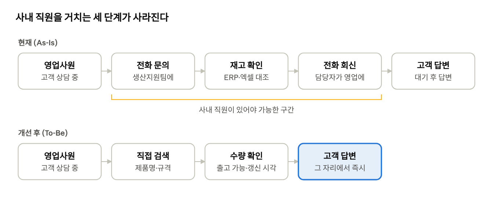
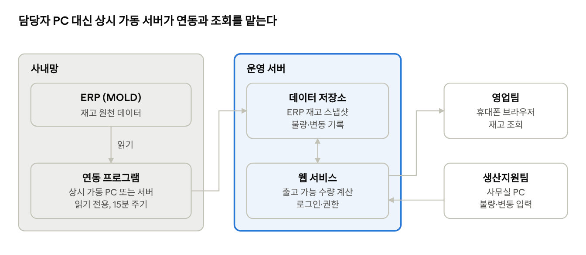

<!-- 원본: docs/새한프라텍_출고재고보드_요구사항정의서_v0.3.docx · pandoc 3.13으로 2026-11-03 변환 후 제목·표 형식만 정리. 내용이 다르면 docx가 우선한다. -->

# 새한프라텍 출고·재고 보드 요구사항 정의서 (v0.3)

외근 영업사원이 어디서든 출고 가능한 재고와

추가 생산 일정을 직접 확인하는 웹 서비스

|               |                                |
|---------------|--------------------------------|
| **고객사**    | 새한프라텍                     |
| **문서 버전** | v0.3 (검토용 초안)             |
| **작성일**    | 2026년 11월 3일                |
| **작성**      | 충북대학교 경영정보학과 김호준 |
| **검토**      | 새한프라텍 담당 이사           |

본 문서는 개발 범위와 기능을 고객사와 합의하고, 개발의 기준으로 삼기 위해 작성되었다.

**CONTENTS**

**목차**

------------------------------------------------------------------------

|        |                         |
|--------|-------------------------|
| **01** | 문제 정의와 목표        |
| **02** | 사용자와 이해관계자     |
| **03** | 사용 시나리오           |
| **04** | 기능 요구사항           |
| **05** | 데이터 정의             |
| **06** | 화면 구성               |
| **07** | 시스템 구성과 ERP 연동  |
| **08** | 비기능 요구사항         |
| **09** | 개발 전 확정할 사항     |
| **10** | 2단계 후보: 디지털 재고 |
| **11** | 부록: 배경              |
| **12** | 검토 및 확인            |

### 개정 이력

| **버전** | **일자** | **변경 내용** | **작성** |
|----|----|----|----|
| v0.3 | 2026-11-03 | 추가 생산 예정·공정 현황·생산 계획 입력·상담 메모 기능 추가 (FR-14~18, NFR-09), 확인 사항 Q11~Q13 추가, 문서 디자인 개편 | 김호준 |
| v0.2 | 2026-11-03 | 문서 양식 정비, 2단계 디지털 재고(10장)와 확인 사항 Q10 추가 | 김호준 |
| v0.1 | 2026-11-03 | 최초 작성 | 김호준 |

## 1. 문제 정의와 목표

> **핵심 문제**
> 출고·재고 보드가 사내망에서만 보여서, 외근 중인 영업사원은 재고를 알려면 사내 생산지원팀 직원에게 전화로 물어봐야 한다.

이 때문에 영업사원은 고객 앞에서 바로 답하지 못하고, 생산지원팀은 문의 응대와 엑셀 수기 보정에 시간을 쓴다. 기존 Claude 데모가 사외 조회를 일부 해결했지만, 담당자 PC에 의존해 언제든 중단될 수 있다.

> **목표**
> 영업사원이 사내 직원을 거치지 않고, 어디서든 출고 가능한 재고를 직접 확인한다.
> 재고가 부족하면 추가 생산이 언제 가능한지까지 안내하고, 고객 상담 내용을 기록해 생산지원팀과 공유한다.

- **POINT 1 · 어디서든 조회**: 휴대폰 브라우저로 로그인해 재고를 바로 확인
- **POINT 2 · 정확한 출고 가능 수량**: ERP 재고에서 불량·변동을 뺀 실제 수량
- **POINT 3 · 추가 생산 일정 안내**: 생산 예정일과 공정 단계, 고객 요청 기록까지

### 1.1 성공 기준

| **기준** | **측정 방법** |
|----|----|
| 재고 확인 목적의 전화 문의가 사라진다 | 도입 전후 생산지원팀 문의 건수 비교 |
| 조회한 수량을 믿고 고객에게 바로 답할 수 있다 | 조회 수량과 실제 출고 가능 수량의 불일치 건수 |
| 담당자 PC가 꺼져도 서비스가 계속된다 | 월간 가동률, 데이터 갱신 누락 횟수 |
| 품목 하나를 10초 안에 찾는다 | 검색부터 결과 확인까지 걸린 시간 |

### 1.2 범위

| **포함 (1단계)** | **제외** |
|----|----|
| 사외(모바일·PC 웹) 재고 조회 | ERP(MOLD) 교체 또는 수정 |
| 출고 가능 수량 계산과 표시 | 수주·발주 입력, 발주 자동 인식 |
| 담당자의 불량·변동 입력 (엑셀 대체) | 생산계획 수립·예측 (등록된 계획의 조회는 포함) |
| ERP 데이터 정기 자동 연동 | 차량 배차·적재율 계산 |
| 서버 기반 상시 운영 | 원부자재 재고 관리 |
| 생산 계획·공정 현황 조회 (생산지원팀 등록 기준) | 설비 연동을 통한 공정 실시간 자동 수집 |
| 고객 상담 메모 기록과 공유 | 고객 관리(CRM)·견적·수주 처리 |

QR·바코드 기반 디지털 재고 전환은 이번 범위(1단계)에서 제외하고, 2단계 후보로 10장에 따로 정리한다.

## 2. 사용자와 이해관계자

시스템을 주로 쓰는 사람은 영업팀(조회)이고, 데이터를 정확하게 유지하는 사람은 생산지원팀(보정)이다. 직원 대부분의 IT 활용 수준이 초급이므로, 모든 화면은 교육 없이 쓸 수 있어야 한다.

| **역할** | **누구** | **하는 일** | **시스템에서 필요한 것** |
|----|----|----|----|
| **조회 사용자** | 영업팀 (외근 영업사원) | 거래처 상담, 발주 접수, 납기 관리 | 휴대폰으로 품목 검색, 출고 가능 수량·갱신 시각·생산 예정일 확인, 상담 메모 기록 |
| **데이터 보정 담당** | 생산지원팀 | 수주 접수, 차량 배차·출고, 재고 관리 | 불량·변동 입력, 생산 계획·공정 상태 등록, 연동 상태와 고객 요청 확인 |
| **운영 관리자** | 미정 (기술연구소 또는 생산지원팀 중 지정) | 사용자 계정, 연동 장애 대응 | 계정 관리, 연동 실패 알림 |
| **의사결정자** | 경영진 | 도입 승인, 운영 비용 결정 | 문의 감소 효과, 운영 비용 |

사업장은 음성과 청주 두 곳이다. 재고를 사업장별로 나눠 관리하는지는 9장(Q2)에서 확인한다.

## 3. 사용 시나리오

개선 후에는 영업사원이 사내 직원 없이 고객 앞에서 바로 답한다. 모든 기능 요구사항은 아래 시나리오를 가능하게 하는 데서 나온다.

그림 1. 재고 확인 흐름 · 현재 5단계, 개선 후 4단계

### 3.1 외근 중 재고 확인 (영업팀)

1.  고객이 “이 규격 500개, 다음 주에 받을 수 있나요?”라고 묻는다.

2.  영업사원이 휴대폰 브라우저로 로그인해 제품명이나 규격 일부를 검색한다. (FR-01, FR-03)

3.  출고 가능 수량과 기준 시각을 확인하고 바로 답한다. (FR-04, FR-05)

### 3.2 불량 발견 반영 (생산지원팀)

1.  출고 전 검사에서 불량 10개가 나온다.

2.  담당자가 변동 입력 화면에 “불량 10개, 사유”를 저장한다. 엑셀은 더 쓰지 않는다. (FR-07)

3.  영업사원 화면의 출고 가능 수량이 즉시 100에서 90으로 바뀐다.

4.  불량이 ERP에 반영되면 변동을 해제해 이중 차감을 막는다. (FR-08)

### 3.3 연동 중단 (운영 관리자)

1.  ERP 연동이 두 번 연속 실패한다.

2.  관리자에게 알림이 가고, 영업사원 화면에는 “데이터가 오래됨” 경고가 뜬다. (FR-05, FR-10)

3.  영업사원은 오래된 수치임을 알고 판단한다. 틀린 숫자를 조용히 보여주지 않는다.

### 3.4 재고 부족 시 납기 안내와 상담 기록

1.  고객이 “300개를 12월 10일까지 받고 싶어요”라고 한다. 출고 가능 수량은 120개뿐이다.

2.  영업사원이 같은 품목 화면에서 생산 예정(12월 5일 완료 예정 500개, 현재 “사출 중”)을 확인한다. (FR-14, FR-15)

3.  “12월 5일 이후 출고 가능”으로 안내하고, 고객명·요청 수량·희망 납기를 상담 메모로 남긴다. (FR-17)

4.  생산지원팀은 품목별 고객 요청을 모아 보고 생산 계획 조정 여부를 판단한다. (FR-18)

## 4. 기능 요구사항

P0만 구현해도 핵심 문제(사외에서 재고를 볼 수 없음)는 해결된다. P1은 조회 결과를 믿을 수 있게 하고 추가 생산 일정까지 안내하며, P2는 편의 기능이다.

| **ID** | **우선순위** | **기능** | **설명** | **완료 기준** |
|----|----|----|----|----|
| FR-01 | P0 | 사외 로그인 | 허가된 직원만 사내망 밖에서 접속한다 | LTE·외부 와이파이에서 로그인 후 조회된다. 미등록 계정은 접근이 막힌다 |
| FR-02 | P0 | 재고 목록 조회 | 전체 품목의 출고 가능 수량을 목록으로 보여준다 | 품목명, 규격, 출고 가능 수량, ERP 재고, 단위가 표시된다 |
| FR-03 | P0 | 검색 | 품목명이나 규격의 일부만 입력해도 찾는다 | 부분 일치, 띄어쓰기 무시로 검색된다. 결과가 1초 안에 나온다 |
| FR-04 | P0 | 출고 가능 수량 표시 | ERP 재고에서 불량·변동분을 뺀 수량을 가장 크게 보여준다 | 5장 계산식과 같은 값이 나온다. 차감 내역을 펼쳐 볼 수 있다 |
| FR-05 | P0 | 마지막 갱신 시각 | 화면 상단에 데이터 기준 시각을 표시한다 | 갱신이 예정 주기보다 늦으면 “데이터가 오래됨” 경고가 뜬다 |
| FR-06 | P0 | 사업장 구분 | 음성·청주 재고를 나눠 보거나 합쳐 본다 | 사업장 필터가 동작한다. 사업장별 관리가 없으면 제외 (Q2) |
| FR-07 | P1 | 불량·변동 입력 | 생산지원팀이 품목별 불량·보류 등 변동 수량과 사유를 입력한다 | 저장 즉시 출고 가능 수량에 반영된다. 입력자와 시각이 기록된다 |
| FR-08 | P1 | 변동 해제 | 불량 처리 완료, ERP 반영 완료 등으로 변동을 종료한다 | 해제하면 계산에서 빠지고 기록은 남는다. 이중 차감이 없다 |
| FR-09 | P1 | ERP 자동 연동 | 사람 개입 없이 ERP 재고를 정해진 주기로 가져온다 | 매일 09:00 기초재고, 이후 15분 간격 갱신. 담당자 PC가 꺼져도 동작한다 |
| FR-10 | P1 | 연동 실패 알림 | 연동이 실패하거나 멈추면 관리자에게 알린다 | 2회 연속 실패하면 메일 또는 메신저로 알림이 간다 |
| FR-14 | P1 | 생산 예정 조회 | 품목별로 앞으로 생산될 수량과 완료 예정일을 보여준다 | 품목 상세에 예정일과 수량이 보이고, 목록에 “추가 생산 예정” 표시가 붙는다 |
| FR-15 | P1 | 공정 현황 표시 | 생산 예정 건마다 현재 단계(계획/사출 중/검사 중/완료)를 보여준다 | 단계와 마지막 변경 시각이 표시된다. 단계 구분은 Q12에서 확정 |
| FR-16 | P1 | 생산 계획·공정 입력 | 생산지원팀이 생산 계획(품목·수량·예정일)과 공정 단계를 등록·수정한다 | 저장 즉시 영업사원 화면에 반영된다. 엑셀 생산계획을 일괄 등록할 수 있다 |
| FR-17 | P1 | 상담 메모 | 영업사원이 품목별로 고객명·요청 수량·희망 납기·상담 내용을 남긴다 | 휴대폰에서 1분 안에 입력된다. 작성자와 시각이 기록된다 |
| FR-11 | P2 | 즐겨찾기 | 자주 보는 품목을 목록 위에 고정한다 | 사용자별로 저장된다 |
| FR-12 | P2 | 변동 이력 조회 | 품목별 재고·변동 기록을 기간별로 본다 | 최근 90일 이력이 조회된다 |
| FR-13 | P2 | 사용자 관리 | 관리자가 계정을 만들고 권한(조회/입력/관리)을 준다 | 퇴사자 계정을 즉시 막을 수 있다 |
| FR-18 | P2 | 고객 요청 모아보기 | 상담 메모를 품목·희망 납기 순으로 모아 생산지원팀이 본다 | 희망 납기가 완료 예정일보다 빠른 요청이 강조된다 |

생산 계획과 공정 현황(FR-14~16)은 설비에서 자동으로 수집하지 않고 생산지원팀이 등록한 값을 기준으로 한다. 추가 생산 시점은 등록된 계획을 보여주는 것이며, 생산 계획을 새로 수립하거나 예측하지 않는다. 출고 예정(배차 완료) 물량을 빼야 하는지에 따라 FR-04와 FR-09의 범위가 달라진다 (Q3).

## 5. 데이터 정의

출고 가능 수량은 ERP 재고에서 아직 ERP에 반영되지 않은 차감분을 뺀 값이다. 예를 들어 ERP 재고가 100개이고 불량 10개가 발견되면 출고 가능 수량은 90개다.

> **계산식**
> 출고 가능 수량 = ERP 재고 − 미반영 불량 − 기타 변동(보류 등) − 출고 예정(확인 후)

변동은 ERP에 반영되는 순간 해제해야 이중 차감이 없다. 해제 규칙(수동/자동)은 Q4에서 정한다. 계산 결과가 0 미만이면 0으로 표시하고 경고를 띄운다.

### 5.1 품목 재고 (ERP에서 가져옴)

| **항목**          | **설명**            | **비고**                       |
|-------------------|---------------------|--------------------------------|
| **품목코드**      | ERP 품목 고유 코드  | 변동 데이터와 연결하는 키      |
| **품목명**        | 제품 이름           | 검색 대상                      |
| **규격**          | 용량·색상·구경 등   | 검색 대상, 표기 방식 확인 필요 |
| **사업장/창고**   | 음성, 청주 등       | 구분이 있을 경우               |
| **ERP 재고 수량** | ERP에 표시된 수량   |                                |
| **단위**          | 개, 박스 등         |                                |
| **기준 시각**     | ERP에서 가져온 시각 | FR-05 표시에 사용              |

### 5.2 재고 변동 (생산지원팀이 입력)

| **항목**                       | **설명**                    |
|--------------------------------|-----------------------------|
| **품목코드·사업장**            | 어느 재고에 대한 변동인지   |
| **유형**                       | 불량, 보류, 출고 예정, 기타 |
| **수량**                       | 차감할 수량 (양수)          |
| **사유**                       | 자유 입력                   |
| **상태**                       | 적용 중 / 해제됨            |
| **입력자·입력 시각·해제 시각** | 추적용                      |

### 5.3 생산 계획·공정 (생산지원팀이 입력)

| **항목**                    | **설명**                                    |
|-----------------------------|---------------------------------------------|
| **품목코드·사업장**         | 어느 품목의 생산인지                        |
| **계획 수량**               | 생산할 수량                                 |
| **착수 예정일·완료 예정일** | 추가 생산 시점 안내에 사용                  |
| **공정 단계**               | 계획, 사출 중, 검사 중, 완료 (Q12에서 확정) |
| **메모**                    | 지연 사유 등                                |
| **수정자·수정 시각**        | 추적용                                      |

생산이 끝나 ERP에 입고되면 재고 수량에 반영되고, 해당 생산 계획은 “완료”로 바뀐다.

### 5.4 상담 메모 (영업팀이 입력)

| **항목**             | **설명**                   |
|----------------------|----------------------------|
| **품목코드**         | 상담한 품목                |
| **고객명(거래처)**   | 상담 고객                  |
| **요청 수량**        | 고객이 원하는 수량         |
| **희망 납기**        | 고객이 원하는 날짜         |
| **상담 내용**        | 자유 입력                  |
| **상태**             | 상담 중 / 수주 전환 / 종료 |
| **작성자·작성 시각** | 추적용                     |

실제 컬럼명과 형식은 기업이 제공할 데모 코드와 샘플 데이터를 받은 뒤 확정한다.

## 6. 화면 구성

화면은 네 개다. 영업사원용 화면(재고 조회, 상담 메모)은 휴대폰 세로 화면을, 생산지원팀용 화면(변동 입력, 생산 계획·공정 입력)은 사무실 PC를 기준으로 만든다.

- **영업팀 · 모바일 · 6.1 재고 조회**: 검색, 출고 가능 수량, 생산 예정
- **영업팀 · 모바일 · 6.4 상담 메모**: 고객 요청과 희망 납기 기록

- **생산지원팀 · PC · 6.2 변동 입력**: 불량·보류 입력과 해제
- **생산지원팀 · PC · 6.3 생산 계획·공정**: 계획 등록, 공정 단계, 고객 요청

### 6.1 재고 조회 화면 (영업팀, 모바일 우선)

1.  상단: 검색창(품목명·규격), 사업장 필터, “기준 시각 10:15” 표시

2.  목록: 한 줄에 품목명과 규격, 오른쪽에 출고 가능 수량을 크게 표시

3.  품목을 누르면: ERP 재고, 차감 내역(불량 10, 보류 0 등), 출고 가능 수량

4.  출고 가능 수량이 0이면 회색, ERP와 차이가 있으면 표시 아이콘

5.  품목 상세 아래: “생산 예정”(완료 예정일·수량·공정 단계)과 “상담 메모 쓰기” 버튼

### 6.2 변동 입력 화면 (생산지원팀, PC)

1.  품목 검색 후 선택

2.  유형(불량/보류/출고 예정/기타), 수량, 사유 입력 후 저장

3.  “적용 중인 변동” 목록에서 해제 버튼으로 종료

4.  화면 상단에 ERP 연동 상태(마지막 성공 시각, 실패 여부)

기존 엑셀 파일을 한 번에 올려 변동을 일괄 등록하는 기능은 엑셀 양식을 확인한 뒤 필요하면 추가한다.

### 6.3 생산 계획·공정 입력 화면 (생산지원팀, PC)

1.  생산 계획 목록: 품목, 수량, 완료 예정일, 공정 단계

2.  새 계획 추가 또는 기존 엑셀 생산계획 업로드

3.  공정 단계를 목록에서 바로 변경

4.  “고객 요청” 탭: 품목별 상담 메모 모아보기 (FR-18)

### 6.4 상담 메모 화면 (영업팀, 모바일)

1.  품목 상세에서 “상담 메모 쓰기” 선택

2.  고객명, 요청 수량, 희망 납기(달력 선택), 상담 내용 입력 후 저장

3.  내가 쓴 메모 목록에서 상태(상담 중/수주 전환/종료) 변경

## 7. 시스템 구성과 ERP 연동

연동과 조회는 개인 PC가 아닌 상시 가동 서버에서 처리하고, ERP는 읽기만 한다. ERP가 사내망 안에 있으므로 사내에서 데이터를 꺼내 서버로 보내는 연동 프로그램이 하나 필요하다.

그림 2. 시스템 구성 · 사내망, 운영 서버, 사용자

### 7.1 ERP 연동 방식 (Q1 답변에 따라 선택)

| **방식** | **내용** | **장점** | **주의점** |
|----|----|----|----|
| **A. DB 직접 조회** | 연동 프로그램이 ERP DB를 읽기 전용 계정으로 주기적으로 조회 | 사람 개입 없음, 갱신 주기를 자유롭게 조절 | DB 종류·접속 권한 확인 필요. 오래된 시스템이라 구조 파악에 시간이 들 수 있음 |
| **B. 내보내기 파일 자동 수집** | ERP가 정기적으로 내보내는 엑셀·CSV를 연동 프로그램이 읽어 전송 | ERP를 건드리지 않음 | 내보내기가 자동인지 확인 필요. 수동이면 다시 사람에 의존 |
| **C. 기존 데모 방식 이관** | 현재 데모의 추출 로직을 상시 가동 장비로 옮김 | 이미 검증된 방식, 가장 빠름 | 데모 코드 검토 후 판단 |

운영 서버를 클라우드에 둘지 사내에 둘지는 Q5에 따른다. 사내 서버라면 외부 접속을 위한 보안 설정(VPN 또는 외부 공개)이 추가로 필요하다. 연동 프로그램은 실패 시 자동으로 재시도하고, 멈추면 FR-10으로 알린다.

## 8. 비기능 요구사항

가장 중요한 조건은 특정 직원의 PC에 의존하지 않는 것과, 재고 데이터가 허가된 직원에게만 보이는 것이다. 기준 수치는 제안값이며 기업과 협의해 확정한다.

| **ID** | **구분** | **요구사항** | **기준 (제안)** |
|----|----|----|----|
| NFR-01 | 가용성 | 연동·웹 서비스가 개인 PC가 아닌 상시 가동 서버(클라우드 또는 사내 서버)에서 돌아간다 | 근무시간 가동률 99% 이상, 장애 후 자동 재시작 |
| NFR-02 | 갱신 주기 | ERP 데이터가 정해진 주기로 반영된다 | 15분 이내 (현행 데모와 동일) |
| NFR-03 | 보안 | 로그인한 직원만 조회, HTTPS 암호화, 계정별 권한 | 퇴사자 즉시 차단, 접속 기록 보관 |
| NFR-04 | 보안 | ERP는 읽기만 한다. 이 시스템이 ERP 데이터를 수정하지 않는다 | ERP 연동 계정은 읽기 전용 |
| NFR-05 | 성능 | 모바일 데이터 환경에서도 빠르게 열린다 | 첫 화면 3초, 검색 1초 이내 |
| NFR-06 | 사용성 | 교육 없이 쓸 수 있는 단순한 화면. 앱 설치 없이 휴대폰 브라우저로 접속 | 처음 쓰는 영업사원이 설명 없이 품목 조회에 성공 |
| NFR-07 | 유지보수 | 외부 개발팀이 빠진 뒤에도 사내에서 운영할 수 있다 | 운영 매뉴얼, 장애 대응 절차 제공 |
| NFR-08 | 데이터 보관 | 재고 스냅샷과 변동 기록을 보관한다 | 최소 1년 보관, 매일 1회 백업 |
| NFR-09 | 개인정보 | 상담 메모의 고객 정보는 권한 있는 직원만 본다 | 영업팀·생산지원팀만 열람, 수정·삭제 기록 보관 |

## 9. 개발 전 확정할 사항

> **우선 확인**
> Q1(ERP 데이터 추출 방식)과 Q5(서버 위치)가 확정되어야 시스템 구조(7장)를 정할 수 있다. 나머지는 기능 세부에 영향을 준다.

| **번호** | **질문** | **관련 항목** | **확인 대상** |
|----|----|----|----|
| Q1 | ERP 데이터를 어떻게 꺼낼 수 있는가? (DB 직접 조회 가능 여부와 DB 종류, 엑셀 내보내기만 가능한지, 기존 데모의 추출 방식) | FR-09, 7장 | 생산지원팀, 기술연구소 |
| Q2 | 재고를 음성·청주 사업장별로 나눠 관리하는가? 영업사원은 나눠서 봐야 하는가? | FR-06 | 생산지원팀, 영업팀 |
| Q3 | 배차가 잡힌 출고 예정 물량도 출고 가능 수량에서 빼야 하는가? 그 정보가 ERP에 있는가? | FR-04, FR-09 | 생산지원팀 |
| Q4 | 지금 엑셀에 변동을 어떤 항목으로 적는가? 불량 외에 빼는 항목이 있는가? 불량은 언제 ERP에 반영되는가? | FR-07, FR-08, 5장 | 생산지원팀 |
| Q5 | 재고 데이터를 사외 클라우드 서버에 두는 것이 보안 정책상 허용되는가? 사내 서버를 쓸 수 있는가? | NFR-01, NFR-03, 7장 | 경영진, IT 담당 |
| Q6 | 영업사원은 조회만 하면 되는가, 출고 요청·예약까지 필요한가? | 범위 전체 | 영업팀 |
| Q7 | 품목 수는 몇 개이고, 규격은 어떻게 표기하는가? | FR-03 | 생산지원팀 |
| Q8 | 영업사원 수와 주로 쓰는 기기는 무엇인가? | FR-01, NFR-05 | 영업팀 |
| Q9 | 서버 운영 비용과 유지보수는 누가 맡는가? | NFR-07 | 경영진 |
| Q10 | 기술연구소의 스마트공장 추진 범위에 재고·바코드 관리가 포함되는가? 포함된다면 일정과 방식은? | 10장 | 기술연구소, 경영진 |
| Q11 | 생산 계획은 지금 어디에 어떻게 관리하는가? (엑셀, ERP 작업지시 등) 얼마나 자주 바뀌는가? | FR-14, FR-16 | 생산지원팀 |
| Q12 | 공정 단계를 어떻게 나누고, 누가 언제 단계를 바꿀 수 있는가? | FR-15, FR-16 | 생산지원팀, 생산팀 |
| Q13 | 상담 메모를 누가 볼 수 있어야 하는가? 고객 정보 보관 기준이 있는가? | FR-17, FR-18, NFR-09 | 영업팀, 경영진 |

기업이 제공하기로 한 기존 Claude 데모 코드와 샘플 데이터를 받으면 Q1, Q4, Q7은 상당 부분 직접 확인할 수 있다.

## 10. 2단계 후보: 디지털 재고

2단계는 실물 재고에 QR 라벨을 붙여 현장에서 스캔으로 재고를 기록하는 방향이다. 1단계(1~9장)를 운영한 뒤 기업과 협의해 추진 여부를 정한다.

### 10.1 필요성

현재 실물 재고에는 QR·바코드가 없어 직원이 눈으로 확인한 뒤 엑셀에 기입한다. 이 수기 과정이 ERP 재고와 실제 재고가 달라지는 근본 원인이다. 1단계는 이 차이를 화면에서 보정하고, 2단계는 차이가 생기는 지점 자체를 없앤다.

### 10.2 후보 기능

| **ID** | **기능** | **설명** |
|----|----|----|
| FR-2-01 | 라벨 발행 | 품목·규격·수량·생산일을 담은 QR 라벨을 박스·팔레트 단위로 출력한다 |
| FR-2-02 | 입고 스캔 | 생산 완료품을 창고에 넣을 때 휴대폰으로 스캔해 재고를 늘린다 |
| FR-2-03 | 출고 스캔 | 차량 적재 시 스캔해 재고를 줄이고 출고 기록을 남긴다 |
| FR-2-04 | 불량·보류 스캔 | 불량 발견 시 해당 박스를 스캔해 출고 가능 수량에서 뺀다 (FR-07 대체) |
| FR-2-05 | 초기 실사 등록 | 도입 시 전체 재고에 라벨을 붙이고 스캔해 기초재고를 만든다 |
| FR-2-06 | ERP 대사 | 스캔 재고와 ERP 재고의 차이를 품목별로 보여준다 |

### 10.3 전제 조건

- 라벨 프린터 도입과 라벨 부착 단위(박스/팔레트) 결정

- 도입 시점에 전체 재고 실사 1회

- 현장 직원이 입고·출고·불량 때마다 스캔하는 운영 규칙

- 기술연구소 스마트공장 추진 계획과의 조율 (Q10)

### 10.4 범위 밖

설비·포장 라인과 연동한 생산 수량 자동 집계, MES 구축은 스마트공장 사업 영역으로 보고 제외한다.

### 10.5 1단계와의 연결

1단계의 변동 기록 구조(5.2)를 그대로 확장해, 2단계에서 다시 만들지 않고 이어갈 수 있게 설계한다.

## 11. 부록: 배경

- 약 30년 된 ERP(MOLD)를 사용하며, 사내에서만 접근할 수 있다.

- ERP 재고에 불량 등 변동이 바로 반영되지 않아, 생산지원팀이 ERP를 엑셀로 내려받아 수기로 보정한다.

- 기업이 Claude로 사외 조회 데모를 만들었다. 매일 09:00 기초재고를 가져오고 15분마다 갱신하지만, 담당자 PC와 Claude 실행 환경에 의존해 종료·충돌 시 갱신이 멈춘다.

- 2026년 6월 사내 설문(13명)에서 생산지원팀은 수작업 엑셀과 재고 부족 시점 파악을, 영업팀은 발주 수작업을 주요 병목으로 꼽았다. 발주 자동 입력과 생산계획 예측은 별도 과제로 본다.

## 12. 검토 및 확인

아래 담당자는 본 정의서를 검토하였다. 9장 확인 사항에 대한 답변을 반영한 뒤 최종본(v1.0)을 확정하고, 이를 1단계 개발의 기준으로 삼는다.

| **구분**    | **소속**                | **성명** | **서명** | **일자** |
|:------------|:------------------------|:---------|:---------|:---------|
| 고객사 검토 | 새한프라텍              |          |          |          |
| 작성        | 충북대학교 경영정보학과 | 김호준   |          |          |
